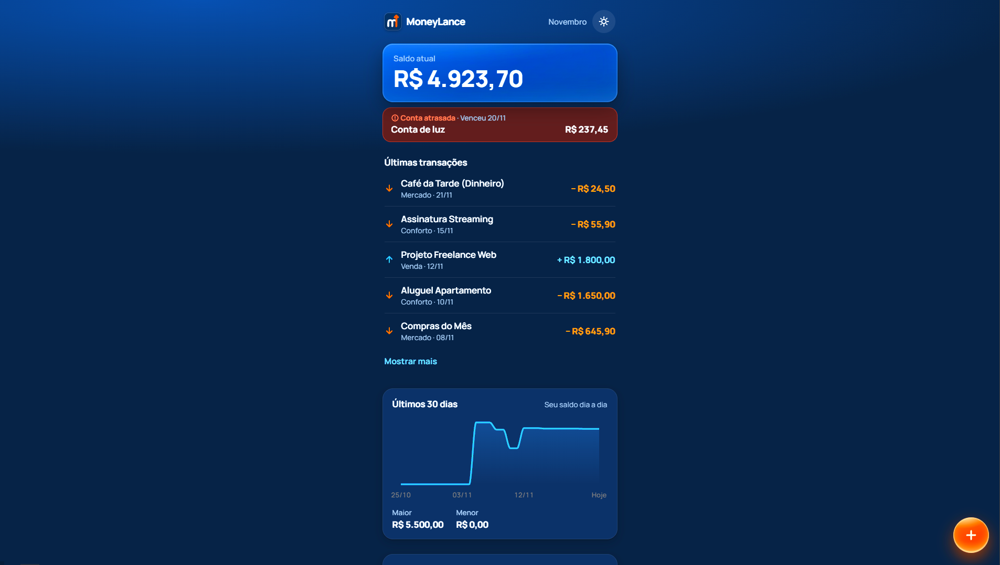

# MoneyLance

A personal finance app for tracking balance, transactions and bills to pay, built for family use.

> **Status:** front-end phase. The app currently runs against mock data. The back-end will live in a separate repository, `moneylance-backend`.

## Demo

Live: [https://daviarendreis.github.io/moneylance-frontend/](https://daviarendreis.github.io/moneylance-frontend/)


| Mobile                                                                         | Desktop                                                                          |
| ------------------------------------------------------------------------------ | -------------------------------------------------------------------------------- |
|  |  |


## Features

- **Current balance:** sum of income minus expenses across all transactions.
- **Transactions:** add income or expenses with description, amount and category. The list is sorted by date, newest first, and shows the 5 latest with a "show more" toggle.
- **Typed categories with icons:** each category is `income`, `expense` or `both`. The category picker only shows categories that match the selected transaction type, and a selected category is cleared if the type changes and it no longer matches.
- **Bills to pay:** add bills with description, amount, due date and a recurring flag, mark them as paid, and see a "to pay / paid" counter.
- **Next bill and overdue alert:** a strip at the top shows the unpaid bill with the closest due date. If it is past due, the strip turns into an overdue alert. If nothing is unpaid, it shows a confirmation instead.
- **Last 30 days chart:** daily running balance over the last 30 days, with the highest and lowest values.
- **Expenses by category:** total expenses and a bar per category showing its share of the total.
- **Light and dark theme:** follows the device setting by default; a manual choice is saved in `localStorage`.
- **Installable as a PWA:** web manifest plus a service worker (`vite-plugin-pwa`) that caches the app shell so it opens offline.
- **Loading and error states:** an error screen with a "try again" button, since an installed PWA has no browser reload button.

Data added in the app lives in React state only and resets on reload, because there is no back-end yet.

## Stack


| Technology                   | Use                                                                                                     |
| ---------------------------- | ------------------------------------------------------------------------------------------------------- |
| React 19                     | UI                                                                                                      |
| TypeScript                   | Static typing for domain models (`Bill`, `Transaction`, `Category`) and components                      |
| Vite                         | Dev server and build                                                                                    |
| Recharts                     | Balance chart, loaded lazily with `React.lazy` so the app renders without waiting for the chart library |
| CSS Modules                  | Component-scoped styles, with shared design tokens in `src/styles/tokens.css`                           |
| vite-plugin-pwa (Workbox)    | Service worker and offline caching                                                                      |
| @fontsource-variable/manrope | Self-hosted font, so it is cached together with the app                                                 |
| ESLint + typescript-eslint   | Linting                                                                                                 |
| gh-pages                     | Deploy to GitHub Pages                                                                                  |


## Architecture

The code is split by responsibility, so each layer can change without touching the others:

```bash
src/
├── api/          # Data layer: async functions returning mock data (bills, transactions, categories)
├── hooks/        # Data hooks: load from api/, hold state, expose actions (addBill, markAsPaid, addTransaction)
├── logic/        # Pure functions: balance, totals, sorting, balance history, date and currency formatting
├── components/   # Presentation components (lists, forms, cards, chart)
│   └── ui/       # Reusable UI pieces (icons, section card, FAB menu, theme toggle)
├── types/        # Domain types and form input types
├── styles/       # Global styles, design tokens, shared glass effect
├── App.tsx       # Composes hooks and components into the single screen
└── main.tsx      # Entry point
```

- **`api/`** is the only place that knows where data comes from. Each function returns a `Promise` with a simulated delay, the same shape a `fetch` call will have. Swapping mock data for the real API means changing these files only.
- **`hooks/`** (`useBills`, `useTransactions`, `useCategories`) call the API layer and handle `loading` and `error` state. Creation inputs are typed with `Omit<...>` (`NewBillInput`, `NewTransactionInput`), so fields like `id`, `createdAt` and `isPaid` are generated in one place and cannot be passed by the form.
- **`logic/`** holds pure functions with no React dependency, such as `getBalance`, `getBalanceHistory`, `getNextBill`, `getTotalExpensesByCategory` and `isOverdue`. Components call them to derive values instead of storing derived state.
- **`components/`** receive data and callbacks through props and focus on rendering.

## Technical decisions

- **Money stored as numbers, formatted only for display.** Amounts are plain `number` values in all calculations. `formatCurrency` uses `Intl.NumberFormat('pt-BR', { style: 'currency', currency: 'BRL' })` at render time only.
- **Date-only values vs. timestamps.** A bill's `dueDate` is a date-only string (`YYYY-MM-DD`), while `createdAt` is a full ISO timestamp. They have separate formatters:
  - `formatDate` formats date-only strings with `timeZone: 'UTC'`, so `"2026-11-20"` does not shift to the previous day in timezones behind UTC (such as Brazil).
  - `formatTimestamp` formats timestamps in the user's local timezone.
- **Local calendar dates for comparisons.** `toYMD` builds a `YYYY-MM-DD` string from local date parts instead of `toISOString()`, which would use UTC. `isOverdue` and `getBalanceHistory` compare these strings directly, which works because the format sorts lexicographically.
- **Derived state is computed, not stored.** Balance, totals, the next bill and the 30-day history are recalculated from the source arrays on each render.
- **Immutable updates.** Sorting copies the array before calling `sort`, and state updates use `map` and spread.
- **GitHub Pages SPA setup.** `base` is set to `/moneylance-frontend/` in `vite.config.ts`, and `index.html` is copied to `404.html` on deploy.

## Running locally

Requires Node.js 20.19+ or 22.12+ and npm

```bash
git clone https://github.com/daviarendreis/moneylance-frontend.git
cd moneylance-frontend
npm install
npm run dev
```

Other scripts:

```bash
npm run build     # type-check (tsc -b) and production build
npm run preview   # serve the production build locally
npm run lint      # ESLint
npm run deploy    # build and publish dist/ to GitHub Pages
```

## Roadmap

- **Planned:** back-end API in a separate repository (`moneylance-backend`) with Node.js, Prisma and PostgreSQL.
- **Planned:** authentication with bcrypt for password hashing and JWT, so each user only sees their own data.
- **Planned:** replace the mock `api/` layer with calls to the real API and persist data.
- **Planned:** complete the PWA experience on phones. The manifest and offline service worker are already in place.

## About the development

The business logic, architecture and data modeling were written by me. 

The visual layer (CSS and SVG) and the PWA setup (manifest, service worker), 

theme toggle and lazy loading of the chart were implemented with AI assistance. 

I reviewed these parts and can explain how they work.

## Author

Davi Arend Reis

- GitHub: [https://github.com/daviarendreis](https://github.com/daviarendreis)
- LinkedIn: [https://www.linkedin.com/in/daviarendreis/](https://www.linkedin.com/in/daviarendreis/)